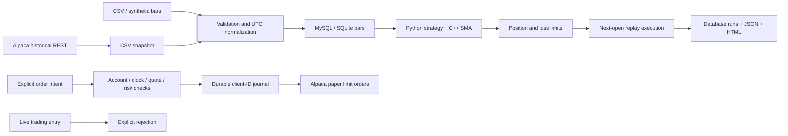

# Architecture and implementation scope

| Component | Files | Verified scope |
|---|---|---|
| Market data and cleaning | `data.py`, `alpaca.py` | CSV workflow, mocked pagination, and real 2024 SPY IEX retrieval |
| Storage | `storage.py` | SQLite and real MySQL ingestion, duplicate checks, transaction rollback, and run persistence |
| Indicators | `strategy.py`, `cpp/indicators.cpp` | Compiled C++ SMA and Python parity |
| Replay execution | `risk.py`, `engine.py` | Next-open fills, costs, cash/quantity limits, and latched halts |
| Paper brokerage | `paper_broker.py` | Mocked account checks, limit-order submission, timeout handling, and client-ID reconciliation |
| Reports | `report.py` | Static HTML equity, summary, and fills; historical JSON per run |
| Live execution | `alpaca.LiveBroker`, CLI `live` | Explicit refusal |

Bar ingestion commits as a transaction. Each replay has a unique run ID. HTML shows the latest result; JSON and database records retain individual runs. The brokerage journal uses SQLite write locking and records intent before network submission. There is no unattended background scheduler and no verified real brokerage order submission. Paper-account authentication and real historical data retrieval have been verified.

Next milestones:

1. Add database migrations, backups, and restore checks.
2. Validate authorized historical US data, exchange calendars, and corporate actions; evaluate out-of-sample behavior and transaction-cost sensitivity.
3. Connect a dedicated paper account, implement continuous strategy scheduling, and validate partial fills, reconciliation, and restart recovery.
4. After separate explicit live-trading approval, review account restrictions and execution controls before a small controlled deployment.
