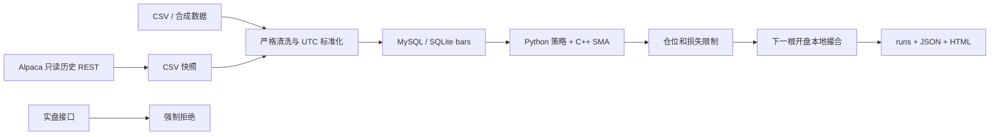

# 架构及完成边界

| 模块 | 文件 | 本次验证 |
|---|---|---|
| 行情与清洗 | data.py / alpaca.py | CSV 完整链路；Alpaca 分页模拟测试 |
| 存储 | storage.py | SQLite 去重、冲突、事务回滚、运行记录；MySQL 待服务环境验证 |
| 指标 | strategy.py / cpp/indicators.cpp | C++ 编译成功；与 Python 多窗口逐项一致 |
| 风控和执行 | risk.py / engine.py | 下一根开盘、成本、停机、数量/资金约束 |
| 报告 | report.py | 生成独立静态 HTML，权益、摘要、成交 |
| 实盘 | alpaca.LiveBroker / CLI live | 拒绝执行测试 |

无外部账户订单、无后台定时程序。数据 ingestion 完成后提交事务，运行结果以唯一 run_id 保存。HTML 为最新运行展示，JSON 和数据库保留独立历史。

后续阶段：

1. 在具备服务的环境运行 MySQL 集成测试，配置备份和迁移版本。
2. 使用授权的历史美股数据验证交易日历与公司行动，做样本外和成本敏感性分析。
3. 实现持续本地模拟的检查点恢复，再接入券商模拟账户，验证状态机、对账和异常恢复。
4. 用户单独确认实盘后，再评审账户限制、实时风控和小额度上线。
